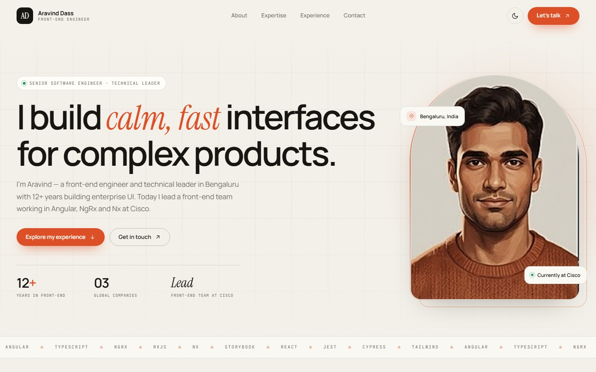
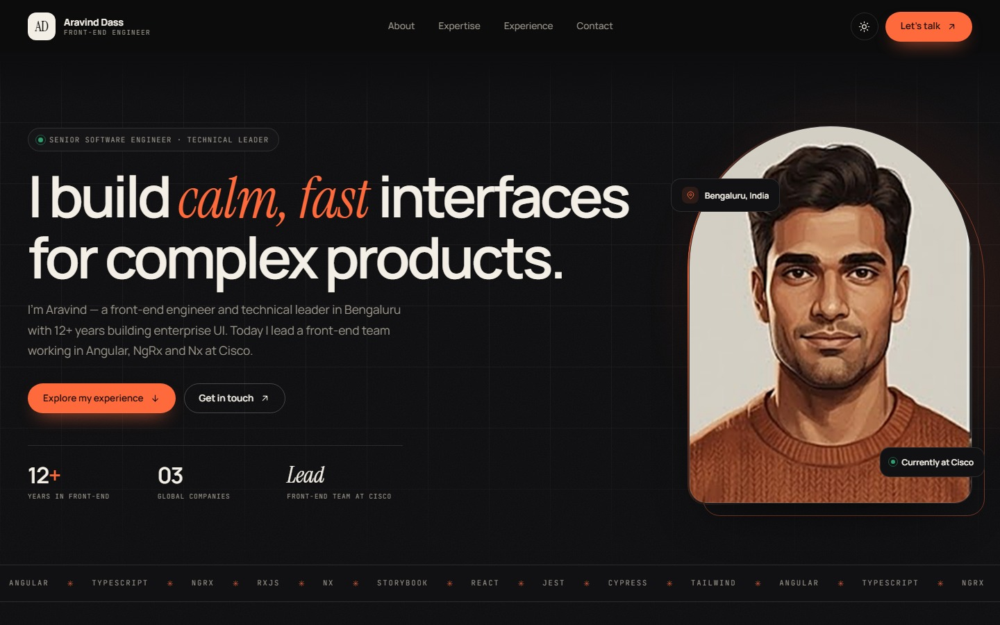
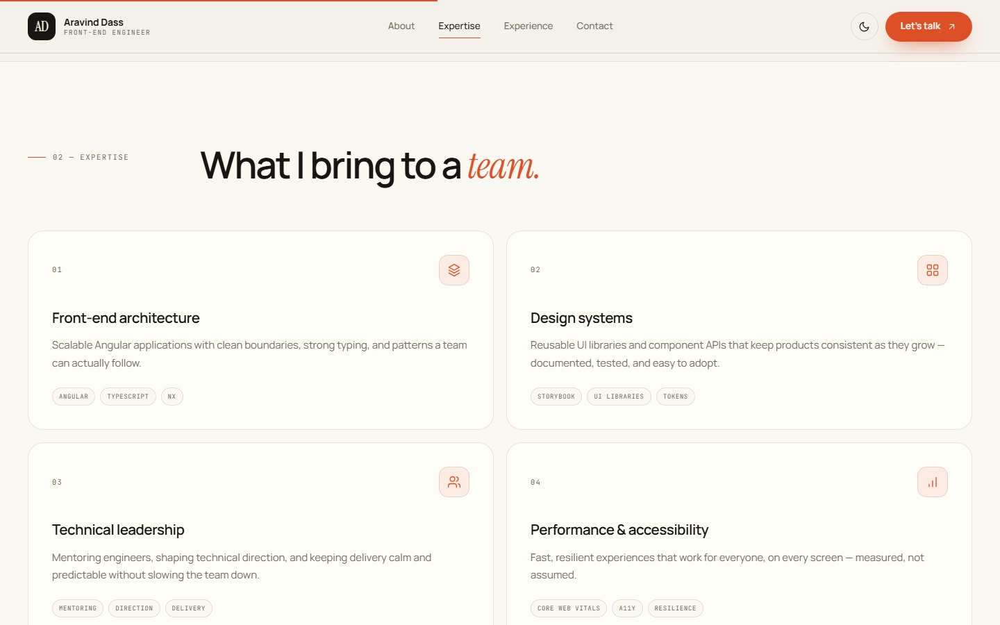
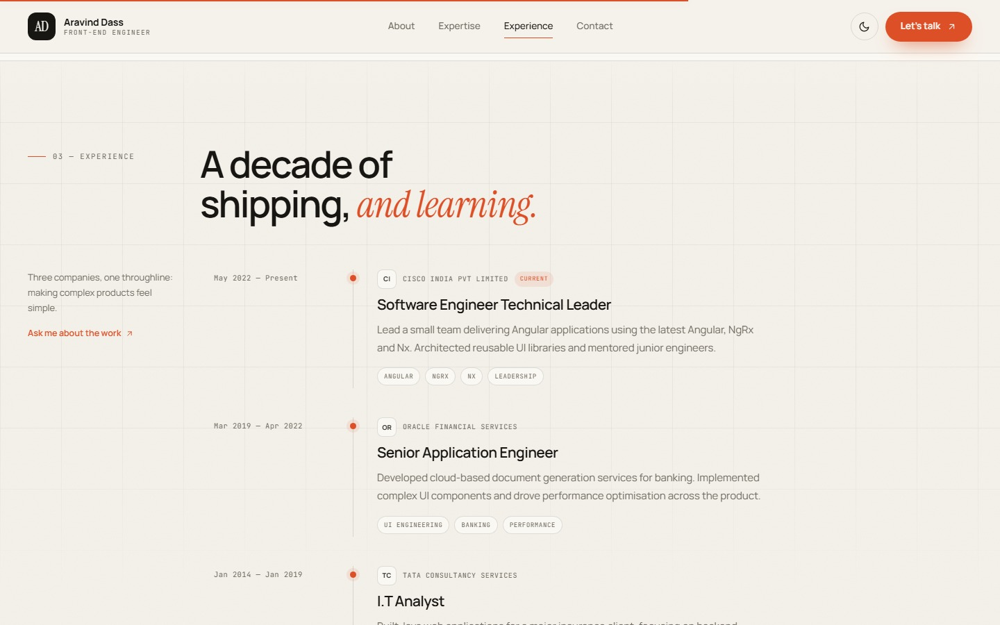
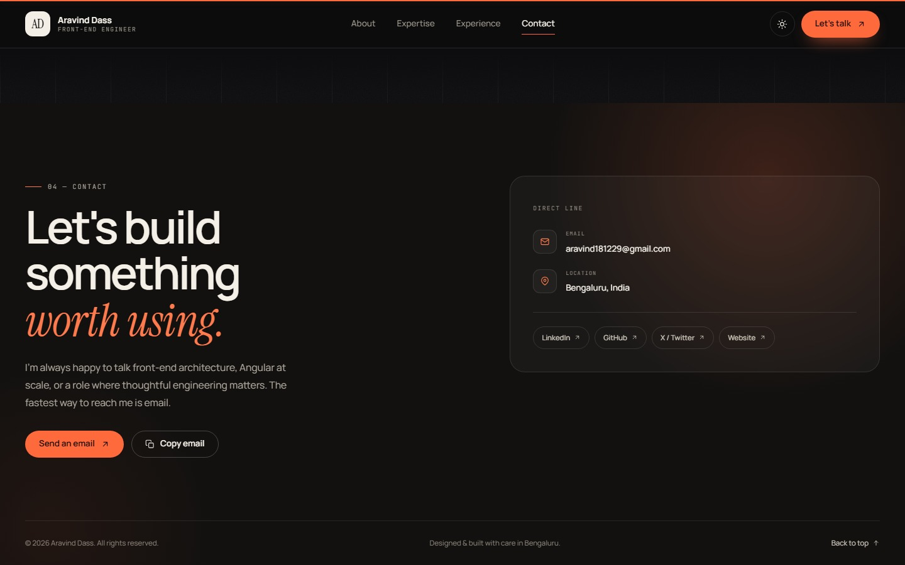

<div align="center">

# Aravind Dass · Portfolio

**A quiet, editorial single-page portfolio for a front-end engineer — hand-written HTML, CSS and vanilla JavaScript. No framework, no build step.**

[](https://aravinddass.github.io)
[](https://www.linkedin.com/in/aravind-dass)
[](mailto:aravind181229@gmail.com)

</div>

---

## Screenshots

**Hero — light and dark themes**

| Light | Dark |
| :---: | :---: |
|  |  |

**Expertise & experience**

| Expertise | Experience |
| :---: | :---: |
|  |  |

**Contact**



## Highlights

- **Light & dark themes** that follow the system preference, with a toggle that remembers your choice.
- **Sticky glass header** with scroll-spy, an active-section underline and a reading-progress bar.
- **Responsive** from wide desktop down to mobile, where the nav collapses into a drawer.
- **Motion with restraint** — scroll-reveal, a pointer-tilt portrait and a soft card glow, all disabled for `prefers-reduced-motion`.
- **Accessible** — skip link, visible focus styles, labelled controls and semantic landmarks.
- **Zero dependencies.** Type is set in Manrope, Instrument Serif and JetBrains Mono from Google Fonts; everything else is hand-written.

## Project structure

```
.
├── index.html                  # the whole page
├── css/
│   └── style.css               # theme tokens + layout + responsive rules
├── js/
│   └── main.js                 # theme, nav, scroll-spy, reveal, copy-email
├── images/
│   ├── portrait.png            # hero portrait
│   ├── photo.jpg               # social share image (og:image)
│   └── aravind_resume.jpeg
├── screenshots/                # images used by this README
└── .github/workflows/snake.yml # contribution-snake generator
```

## Run locally

There is nothing to install or build — just serve the folder and open it:

```sh
# from the repository root
python -m http.server 8000
# then open http://localhost:8000
```

## Deploy

The site is published with **GitHub Pages** straight from the `master` branch — commit and push, and the change goes live at <https://aravinddass.github.io>.

## Notes

- This repository contains the **website only**. The GitHub profile README (the one that renders on <https://github.com/aravinddass>) lives in the separate **[`aravinddass/aravinddass`](https://github.com/aravinddass/aravinddass)** repository.
- `.github/workflows/snake.yml` regenerates the contribution snake and publishes it to this repo's `output` branch, where the profile README references it.

<div align="center">
<sub>Designed &amp; built in Bengaluru.</sub>
</div>
